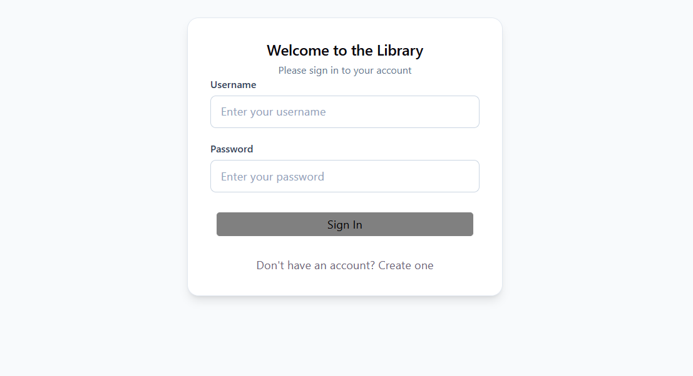
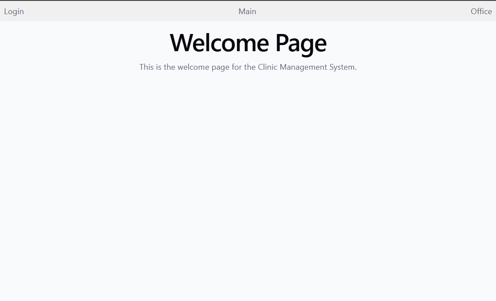
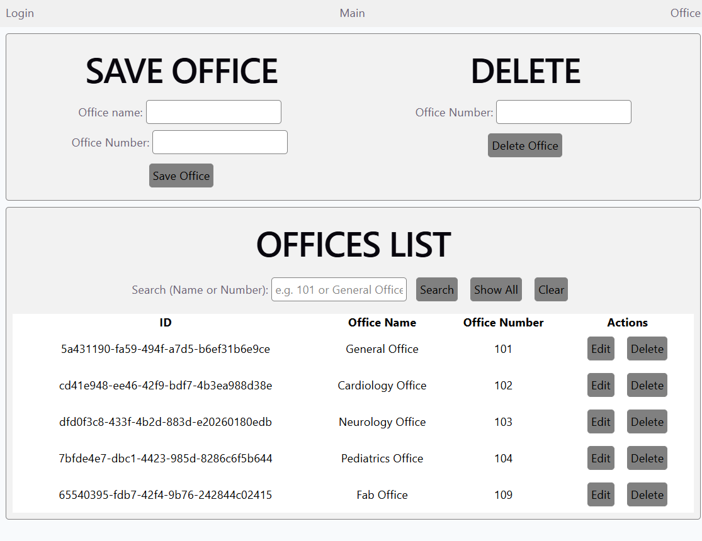

# Clinic Wednesday 27089 — Frontend

React + Vite frontend for the Clinic management system. It lets users log in and manage **offices** (create, view, update, delete, and search by number or name) through the Spring Boot backend.

🔗 **Backend repository:** [Clinic_Wednesday_27089](https://github.com/PrinceCuthbert/Clinic_Wednesday_27089)

## Tech Stack

- React 19 + Vite
- React Router
- Axios (HTTP requests to the backend)
- Tailwind CSS

## Pages

| Route     | Description                                      |
|-----------|--------------------------------------------------|
| `/login`  | Login page                                       |
| `/main`   | Main dashboard                                   |
| `/office` | Office management (CRUD + search)                |

## Screenshots

### Login



### Main Page



### Office Management



## Running the Project

1. Start the backend first (see the [backend repo](https://github.com/PrinceCuthbert/Clinic_Wednesday_27089)). It must run on `http://localhost:8080`.
2. Install dependencies and start the frontend:

```bash
npm install
npm run dev
```

3. Open the URL shown in the terminal (usually `http://localhost:5173`).

## API Endpoints Used

| Method | Endpoint                          | Purpose               |
|--------|-----------------------------------|-----------------------|
| GET    | `/api/offices`                    | List all offices      |
| GET    | `/api/offices/{number}`           | Find office by number |
| GET    | `/api/offices/by-name/{name}`     | Find office by name   |
| POST   | `/api/offices/save`               | Create an office      |
| PUT    | `/api/offices/update/{number}`    | Update an office      |
| DELETE | `/api/offices/delete/{number}`    | Delete an office      |

## Author

ISHIMWE Prince Cuthbert — 27089
